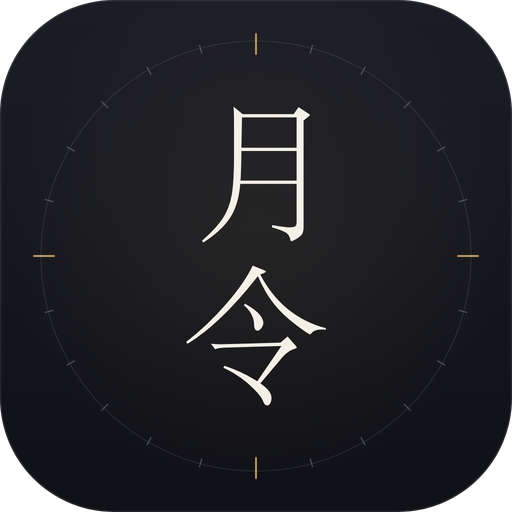
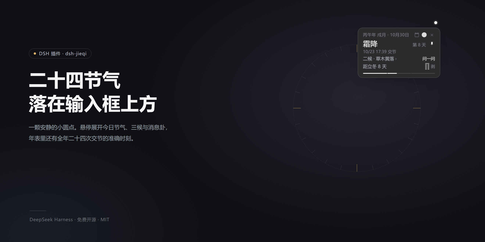
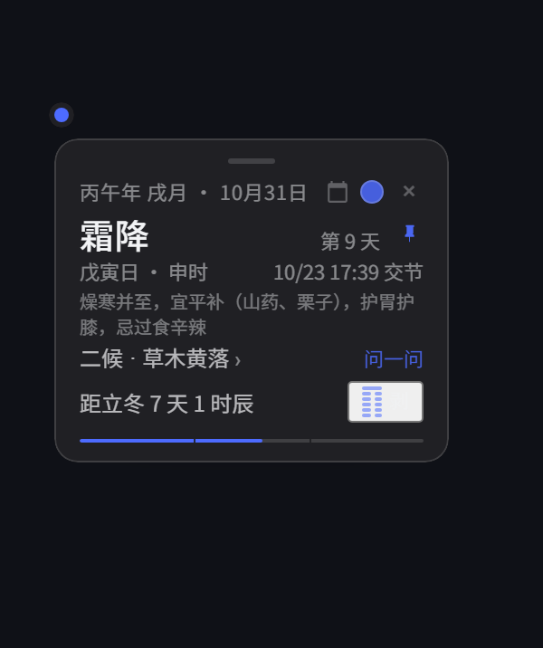
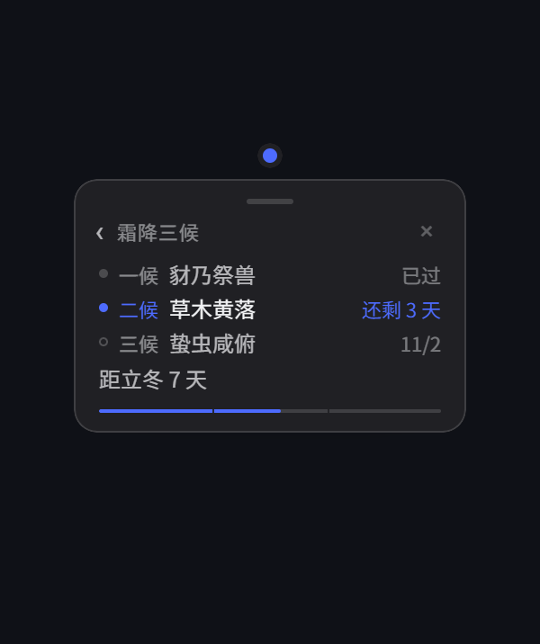
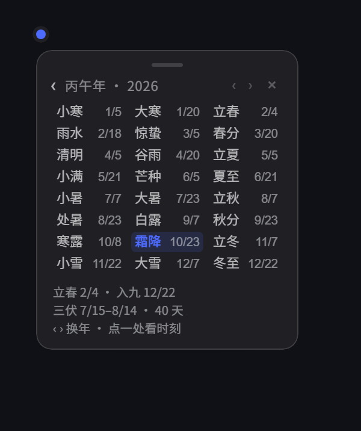
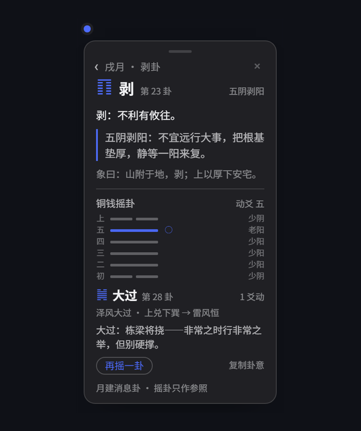
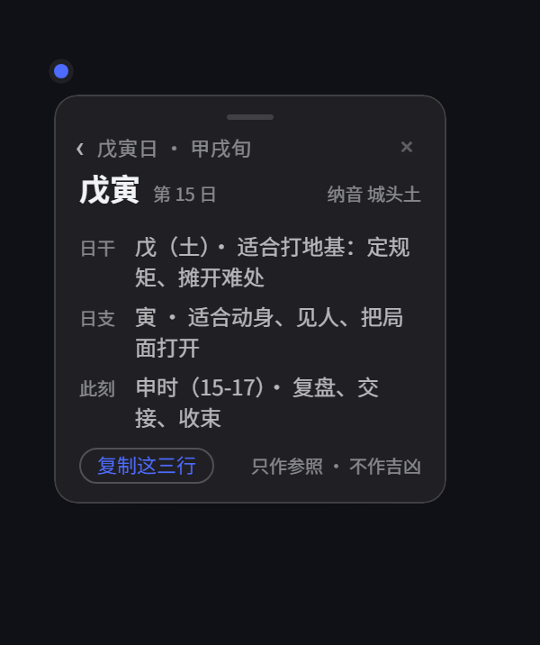
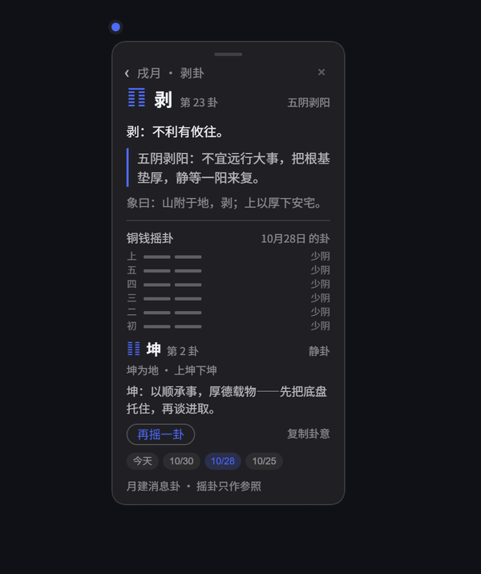

# Yueling · 24 solar terms

**The 24 solar terms, floating above your input box.**

A quiet dot sits on the lower edge of the DeepSeek Harness chat title bar. 
Hover it and it blooms into today's card. The whole card is draggable, and one click folds today into a single line.

 

 

Offline · no model calls · no extra sidebar slot 
Every transition instant is computed locally from the sun's apparent longitude

> The card faces are the real component rendered standalone in a browser (same client.js); the outer shell is illustrative.

🫧 Hover the dot and the card swells out of it — recorded, not mocked up

---

## ✨ What it is

| Trait | What it means |
| :---: | --- |
| 🎯 **One dot** | No sidebar slot, no focus steal, collapses when the mouse leaves |
| 🧮 **Computed locally** | Sun's apparent longitude + ΔT, works offline |
| 🀄 **The old calendar** | Sexagenary year · month branch · day pillar · double-hour · 72 pentads · 12 sovereign hexagrams · 三伏/数九 |
| 📋 **One line** | Click anywhere on the card to copy today as a single summary |
| 🎲 **Cast a hexagram** | Three coins, six throws, six lines settle bottom-up, one sentence of meaning |
| 🫧 **Drag anything** | The whole card moves; park it at an edge to leave a slim tab |
| 🎨 **Eight palettes** | One of them follows the season (spring green, autumn gold, winter blue) |
| 🔔 **Term reminder** | Opens an hour early and posts a system notification at the exact instant |

~~~text
⬤ dot ── hover ──▶ 🌤 today ──┬── tap pentad ──▶ 🍃 pentads
                              ├── tap calendar ─▶ 📅 year table
                              ├── tap day pillar ▶ 🧭 day pillar · what suits today
                              └── tap hexagram ▶ ☯️ hexagram · cast · 7-day log
~~~

---

## 🎑 Six faces

| 🌤 Today · term · day pillar · tip · countdown | 🍃 Pentads · days left in each |
| :---: | :---: |
|  |  |
| 📅 **Year table** · all 24 instants | ☯️ **Hexagram** · month branch · sovereign hexagram · casting |
|  |  |
| 🧭 **Day pillar** · nayin · decade · what suits today | 🗂️ **Seven days** · the casts of the past week |
|  |  |

---

## 🌤 What it does

### 1. Today

- 🗓 Sexagenary year (switches at 立春), month branch (switches at the 12 节), day pillar (rolls over at Beijing midnight), Gregorian date
- 🕰 The double-hour you are in right now (子时 spans 23:00–01:00), with its stem derived from the day stem by the five-rats rule; hover the line to see 庚申时 · 15-17
- 🧭 **Day pillar page**: tap that line for the day count, 纳音 (e.g. 城头土), the decade it falls in (甲戌旬), and one neutral sentence each for the stem, the branch and the current double-hour — what suits today, never fortune-telling
- 🌡 Term name, exact transition instant, day within the term
- 🍃 Which of the 72 pentads today falls in; tap through for all three
- ⏳ Days and **double-hours** until the next term (1 时辰 = 2 hours, e.g. 「距立冬 7 天 1 时辰」), with a thin progress bar; a live countdown on the term day
- 🥣 A one-line seasonal tip (from the bundled 节气养生速查 reference)
- ☯️ The sovereign hexagram for the month branch, drawn with six lines
- 🎲 The 卦 page can cast: three coins six times, six lines landing bottom-up, the primary and changed hexagram, one sentence of meaning

### 2. On the term day it shows up by itself

- ⏰ Auto-opens **one hour** before the transition, with a brand-colored hairline on top
- 🔔 Posts a **system notification** at the instant (permission requested on first dot click, not on page load)
- 1️⃣ One notification per term; works even if the page has been open overnight
- 🌊 The dot grows slightly and gives one soft ripple on a term day

### 3. Placement

- 📌 The dot docks under the chat title bar and can be dragged horizontally
- 🫳 The entire card is a handle too: press anywhere on the body to move the window, release and it glides with a little inertia
- 🫧 Park it at the left or right edge and it shrinks into a slim tab that expands inward on hover
- 🎯 Double-click or right-click the dot to return to the center
- 📍 Click the dot (or focus and press Enter / Space) to pin the card
- ⌨️ **Alt+J** toggles it globally without stealing focus
- ✖️ × only hides it for today; the dot stays
- 💾 Position, pin state, current page and palette are remembered

### 4. Year table, 三伏 and 数九

- 📅 The calendar icon opens a 3×8 table of the year; tap any term for its exact instant
- 🧭 The footer lists 立春, the first day of 数九, and the 三伏 range
- 🔥 While 三伏 or 数九 is active the countdown line shows it first: 初伏 6 days · 3 days to 大暑
- 🧮 初伏 = third 庚 day after 夏至; 末伏 = first 庚 day after 立秋; 数九 runs 81 days from 冬至

### 5. Cast a hexagram

- 🪙 Three coins, six throws: a back counts 3, a face 2 — 6 old 阴, 7 young 阳, 8 young 阴, 9 old 阳, the old coin method
- 🎲 The randomness is window.crypto.getRandomValues with rejection sampling (no modulo bias), entirely local, no request
- ⬇️ The six lines land one at a time from the bottom (112 ms each); moving lines are marked ○ or ×, then the primary and changed hexagram are read out
- 🧾 One sentence per hexagram, all sixty-four: 「大过：栋梁将挠 —— 非常之时行非常之举，但别硬撑」
- 📋 「复制卦意」 copies the date, number, trigrams, moving lines, changed hexagram and the sentence; 「再摇一卦」 throws again
- 🗂️ Casts stay for seven days: a row of date chips at the bottom of the 卦 page (today / 10/30 / 10/28 …) switches the view, the today chip is highlighted, tap it to come back; older entries fall off
- 💾 Today's cast is remembered across page switches and restarts; reduced motion settles it at once

### 6. Details

- 🌙 Rolls over at local midnight, on page visibility change, and on window focus
- 📱 Under 480px the card collapses into a single row
- 🎨 Eight palettes: season-following, brand, and 竹青 / 松绿 / 绛紫 / 秋香 / 赭石 / 靛青
- 📋 Click anywhere to copy the summary (a drag over 3px is not a click); a small “copied” badge flashes; “问一问” puts a ready-made question in the composer
- 🔔 The term notification opens the card when clicked; a cold start uses the last cached result
- 📴 Local fallback when the host route is unreachable; the card still renders
- 🧯 Failing routes, denied notifications and full localStorage all degrade silently

---

## 📦 Install

> 📦 The repository root is the package: `package.json`, `cordis.patch.yml`, `lib/` and `assets/` sit at the top (no `plugin/` subdirectory since 0.9.1), so the package name, the GitHub address and a local folder all point at the same place.

### Option 1 — “Add plugin” page (fastest ✅)

The plugin page accepts a package name, a GitHub address or a local folder.

**From npm** (no git required):

~~~text
dshjieqi-card
~~~

**From GitHub** (when npm is unreachable, or you want the latest commit):

~~~text
github:SDSAEWQ/yueling
~~~

No #path suffix needed — the repository root is the package. Restart DSH (or press Ctrl+R), and a dot appears above the input box 🫧

> **❓ Why is the plugin id now dshjieqi-card?** Both dshjieqi and dsh-jieqi were taken on npm (0.0.1 stubs), and npm rejects names that differ only in punctuation. Since 0.11.2 the plugin id and the npm name are the same: the catalogue builder resolves a plugin by reading the repo's package.json name, looking that exact package up on npm and checking its repository points back at the repo — a mismatch keeps the plugin out of the official index forever, and leaves the version/downloads fields blank in the market card.
>
> 🏷 **Renamed & migrated**: since Oct 2026 the repository is **Yueling** (`SDSAEWQ/yueling`) and the old `SDSAEWQ/dsh-jieqi` URL redirects. From 0.11.2 the plugin id changed from dsh-jieqi to dshjieqi-card — uninstall the old one first (or drop the dsh-jieqi line from your profile), otherwise two dots show up. Stored preferences keep the old localStorage prefix and will not carry over.

### Option 2 — Marketplace index (recommended)

DSH ships without a marketplace, but the Discover page accepts any index URL:

1. **Plugins** → **Experimental plugins** → **More** → enable **Custom plugin marketplace**
2. **Discover** → **Add index** → paste:

   ~~~text
   https://cdn.jsdelivr.net/gh/SDSAEWQ/yueling@main/market/index.json
   ~~~
3. Search for dshjieqi-card or yueling (listed as **Yueling**) and hit install

The jieqi skill is registered with the plugin, so option 4 becomes unnecessary.

⚠️ Marketplace installs use a git source; git must be installed. Otherwise use the manual route.

> 💡 CLI equivalents (the desktop profile is usually locked by Electron — prefer the UI):
>
> ~~~text
> dsh plugin --profile web add dshjieqi-card
> dsh plugin --profile web add github:SDSAEWQ/yueling
> ~~~

### Option 3 — Manual (no git)

1. Download the repo (Code → Download ZIP) and copy the repository root to **%USERPROFILE%\.dsh\plugins\dshjieqi-card** (`docs/` and `market/` are optional)
2. Add a local link dependency in **%USERPROFILE%\.dsh\profiles\desktop\package.json** and append dshjieqi-card to dsh.profile.bundles
3. Append the insert patch to **cordis.patch.yml**:

   ~~~yaml
   - insert:
       - id: jieqi
         name: dshjieqi-card
   ~~~
4. Create a directory junction:

   ~~~powershell
   New-Item -ItemType Junction -Path "$env:USERPROFILE\.dsh\profiles\desktop\node_modules\dshjieqi-card" -Target "$env:USERPROFILE\.dsh\plugins\dshjieqi-card"
   ~~~
5. Quit DSH completely and reopen it.

### Option 4 — Skill only (for the model, not the card)

Copy **assets/jieqi** to **%USERPROFILE%\.agents\skills\jieqi**. Then ask “which solar term is today”, “how many days to 立冬”, or run it directly:

~~~text
node scripts/jieqi.mjs
node scripts/jieqi.mjs 2026-12-22
node scripts/jieqi.mjs --json
node scripts/jieqi.mjs --year
~~~

---

## 🖱️ Cheat sheet

| Do this | It does that |
| :--- | :--- |
| 🖱️ Hover the dot | Opens the card, closes when the mouse leaves |
| 📌 Click the dot / Enter / Space | Pins the card |
| ⌨️ **Alt+J** | Toggles the card globally |
| 🫳 Drag the dot | Docks to the title bar, free position, or a slim edge tab |
| 🫴 Drag the card body | Moves the whole window with inertia |
| 🔔 Click the notification | Opens the card |
| ↩️ Double / right click the dot | Back to center |
| ✖️ Click × | Hides it for today |
| 🍃 Tap the pentad line | Pentads page |
| 📅 Tap the calendar icon | Year table, ‹ › to change year |
| ☯️ Tap the hexagram | Hexagram page |
| 🧭 Tap 「戊寅日 · 申时」 | Day pillar page: nayin, decade, what suits today |
| 🗂️ Tap a date chip on the 卦 page | Review a past cast |
| 🎲 Tap 「摇一卦」 | Three coins, six throws, lines land one by one |
| 📋 Tap 「复制卦意」 | Copies the hexagram and its sentence |
| 🎨 Tap a palette dot | Eight palettes |
| 📋 Click empty card space | Copies the one-line summary |
| ⎋ Esc / ‹ | Back |

---

## 🔌 Host routes

| Method | Path | Description |
| :--- | :--- | :--- |
| GET | /plugins/dshjieqi-card/api/today?date=YYYY-MM-DD | Term, sexagenary, pentad, hexagram for a date (defaults to today) |
| GET | /plugins/dshjieqi-card/api/year?year=YYYY | All 24 terms of a year with exact instants |

~~~json
{
  "ok": true,
  "date": "2026-10-30",
  "term": "霜降",
  "termAt": "2026-10-23T17:39:00+08:00",
  "isTermDay": false,
  "dayInTerm": 8,
  "tip": "燥寒并至，宜平补（山药、栗子），护胃护膝，忌过食辛辣",
  "next": { "name": "立冬", "at": "2026-11-07T17:49:00+08:00", "days": 8 },
  "ganzhi": {
    "year": "丙午",
    "monthBranch": "戌",
    "monthStart": "寒露",
    "day": { "index": 14, "name": "戊寅" },
    "hour": { "index": 8, "name": "申时", "full": "庚申时", "range": "15-17" }
  }
}
~~~

ganzhi.hour is only filled in when date is omitted (that is, for today); with ?date= it is null, because a past day has no "what time is it now".

The client calls this local route only; no external requests.

---

## 🎯 Accuracy

- 🧮 Meeus low-precision apparent solar longitude + Espenak–Meeus ΔT + bisection
- 📏 Within about **2–6 minutes** of the Purple Mountain Observatory values; dates are reliable
- 🕗 Fixed to UTC+8 (no DST), years 1900–2100
- 🀄 The sexagenary year switches at 立春 and the month branch at each of the 12 节 — the calendrical convention, not the lunar month
- 🎲 Casting uses local cryptographic randomness (crypto.getRandomValues + rejection sampling), unrelated to the old 「以钱代蓍」 sensitivity; the sentences follow each 卦's meaning and are for reference, not a judgement of fortune

---

## 🧪 Development

Zero dependencies, no build step:

~~~text
npm test        # node test/smoke.mjs
~~~

The smoke test loads client.js into a fake window inside plain Node, checks that the module loader can take it and that apply() registers the slots, pins a few day-pillar anchors (2026-10-31 is 戊寅, 1949-10-01 is 甲子, 2024-02-10 is 甲辰), asserts that lib/astro.mjs and assets/jieqi/scripts/astro.mjs are byte-identical, that both routes answer 200, and that the bundled skill body carries no YAML frontmatter.

On push, GitHub Actions (.github/workflows/ci.yml) runs the same set: node --check on five files plus npm test.

---

## 🗂️ Layout

~~~text
yueling/                    ← repository root = the plugin package
├─ package.json            dsh manifest, exports, npm metadata
├─ cordis.patch.yml        mount declaration
├─ lib/
│  ├─ astro.mjs            the only implementation of the term maths
│  ├─ index.js             host: two read-only JSON routes
│  └─ client.js            browser: the dot, six faces, the hexagrams
├─ assets/jieqi/           bundled skill (SKILL.md + scripts + references)
├─ market/index.json       index you can add to the marketplace
├─ test/smoke.mjs          zero-dependency smoke test (npm test)
├─ .github/workflows/      ci.yml: syntax + smoke
├─ docs/                   screenshots, demo gif, icon and BEHAVIOUR.md
├─ README.md / README.en.md
└─ CHANGELOG.md
~~~

## 🧹 Uninstall

Remove dshjieqi-card from package.json and cordis.patch.yml, delete the junction and the plugin folder, restart DSH. localStorage keys prefixed dshjieqi-card.* may stay.

## 📄 License

MIT © 2026 SDSAEWQ

🌗 Instants first · casting for reference · no fortune-telling 🎲

