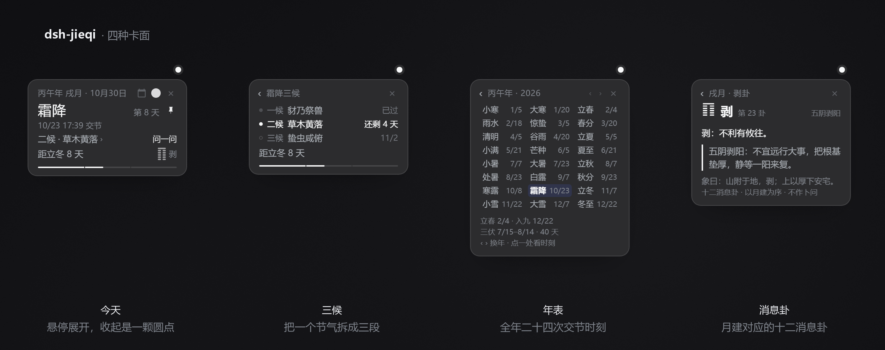

# dsh-jieqi · solar terms above the composer

A quiet 8px dot under the conversation header of the DeepSeek Harness Web GUI.
Hover it and it unfolds into today's solar term: the 干支 year, the month branch,
which day of the term, the exact instant it began, the current 候, the next term,
and the 消息卦 of the month.

No network, no model call, no sidebar slot. Every instant is solved locally from
the Sun's apparent longitude.

> The cards are the real component rendered standalone in a browser (the same
> client.js); the chrome around them is illustrative.

MIT · plugin 0.3.0 · DSH 0.2.x desktop · any platform with the Web GUI

---

## Four faces

- **Today** — 干支 year, month branch, date, term, day count, instant, current 候,
  countdown to the next term, 消息卦.
- **三候** — the term cut into its three 候: past, current (counting down), upcoming.
- **Year** — all 24 terms of a year with their instants; walk 1900–2100.
- **Hexagram** — the 消息卦 of the month: glyph, number, 卦辞, one plain sentence, 象曰.

## What it does

- Docks under the conversation header; drag it along the rail, drop it anywhere,
  or push it to a side edge where it becomes a half-hidden tab.
- Hover to unfold; click (or Enter / Space) to pin open; **Alt+J** toggles from
  anywhere; double-click or right-click returns it to the middle.
- On a term day it unfolds itself one hour before the instant, shows a brand bar,
  and fires one system notification at the exact instant. Permission is asked on
  the first click, never on page load.
- The date is re-read at local midnight, on visibility change and on focus, so a
  window left open overnight is never stale.
- 年表 page with 立春 / 数九 / 三伏 for the year; 三伏 and 数九 lead the countdown
  line while they run.
- Eight accents, including one that borrows each term's own tint.
- Under 480 px the card becomes a single line; every state is remembered.
- Degrades quietly: host route down, notifications denied, storage full — the dot
  still works.

## Install

### Custom plugin market

1. **Plugins** → **Experimental plugins** → **More** → enable **custom plugin
   market**.
2. **Discover** → **Add index**:

   ~~~text
   https://raw.githubusercontent.com/SDSAEWQ/dsh-jieqi/main/market/index.json
   ~~~

3. Install **Jieqi**. The market installs from git, so git must be on PATH.

### Manually (no git)

1. Copy **plugin/** to %USERPROFILE%\.dsh\plugins\dsh-jieqi
2. Add to **%USERPROFILE%\.dsh\profiles\desktop\package.json**:

   ~~~json
   "dependencies": { "dsh-jieqi": "link:C:/Users/<you>/.dsh/plugins/dsh-jieqi" }
   ~~~

   and append "dsh-jieqi" to dsh.profile.bundles.
3. Append to **%USERPROFILE%\.dsh\profiles\desktop\cordis.patch.yml**:

   ~~~yaml
   - insert:
       - id: jieqi
         name: dsh-jieqi
   ~~~

4. Link it into the profile:

   ~~~powershell
   New-Item -ItemType Junction -Path "$env:USERPROFILE\.dsh\profiles\desktop\node_modules\dsh-jieqi" -Target "$env:USERPROFILE\.dsh\plugins\dsh-jieqi"
   ~~~

5. Quit DSH completely, reopen it, then press Ctrl+R in the window.

### As a skill

Copy **skill/jieqi** to %USERPROFILE%\.agents\skills\jieqi. Then use **/jieqi**
or just ask "what solar term is it today". The skill runs the bundled script, so
the model computes instead of recalling.

~~~text
node scripts/jieqi.mjs                # today
node scripts/jieqi.mjs 2026-12-22     # a date
node scripts/jieqi.mjs --json         # machine readable
node scripts/jieqi.mjs --year         # the year's 24 instants
~~~

## Accuracy

Meeus low-precision apparent solar longitude, Espenak–Meeus ΔT, bisection. Within
a couple of minutes of the Purple Mountain Observatory values; dates are reliable.
Fixed to UTC+8. Years 1900–2100. The 干支 year turns at 立春 and the month branch
at the 12 節, as 命理 expects.

## Layout

~~~text
plugin/          host + browser halves, one shared astro.mjs
skill/jieqi/     the same algorithm as a CLI skill
market/index.json  a format-1 custom market index
docs/            screenshots and icon
~~~

## License

MIT © 2026 SDSAEWQ
